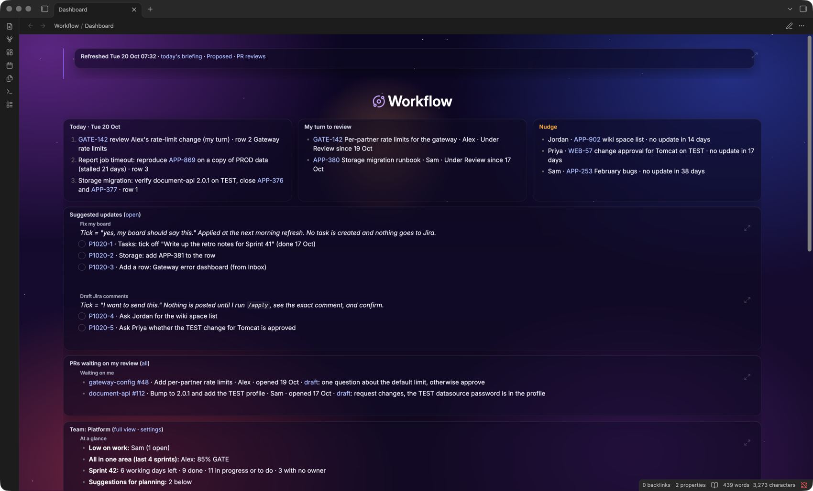
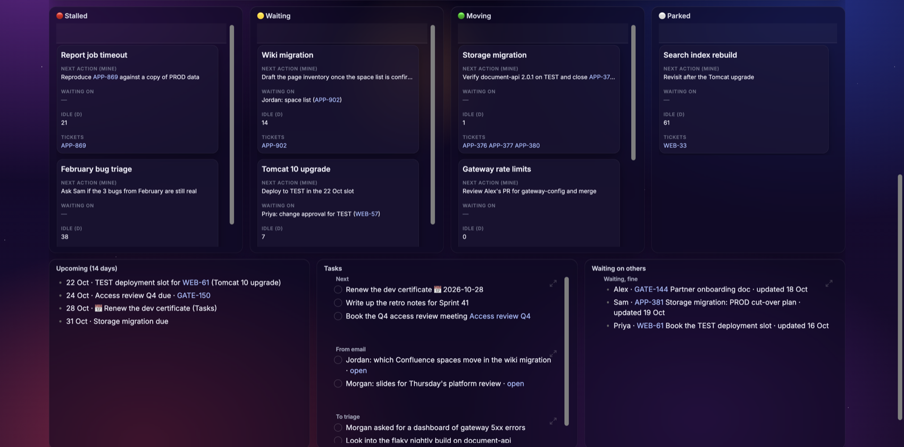

# Obsidian Jira dashboard

[](https://github.com/bcgov/repomountie/blob/master/doc/lifecycle-badges.md) [](LICENSE)



*Example data. Every name, ticket, repository and host in the screenshots is made up.*

A one-screen personal work dashboard in Obsidian, refreshed every morning by an AI agent (Claude Code or GitHub Copilot) from Jira, your workstream notes and your inbox. Jira stays the system of record for anything the team can see. The vault holds only what Jira cannot: your next step per workstream, what you are waiting on from others, and uncommitted captures.

Nothing in the daily refresh writes to Jira. Changes to your board land in `Proposed.md` as checkboxes; you tick the ones you agree with. Jira comments are drafted, never posted, until you run the `apply` workflow and confirm the exact calls.

Read `WORKFLOW.md` for the design and the daily cadence.

## How it fits together

```
prompts/*.md              the four workflows, written for any agent
  ├── .claude/commands/   Claude Code: /standup, /weekly, /prreview, /apply
  └── .github/agents/     Copilot: agents standup, weekly, prreview, apply
AGENTS.md                 rules every agent reads (CLAUDE.md imports it)
bin/standup-daily.sh      launchd runner; AGENT=claude|copilot in config.env
vault/                    skeleton notes and the dashboard CSS to copy into your vault
```

Edit a workflow in `prompts/`; the adapters only declare tools and point at it.

Further down the same note: one column per workstream status (a Bases card view over the notes in `vault/Workflow/Workstreams/`), upcoming dates, small tasks and what you are waiting on from others.



## What is in here

| Path | What it is |
|---|---|
| `WORKFLOW.md` | The design: what lives where, the rules, the cadence |
| `AGENTS.md` | Rules and paths for any agent working here; `CLAUDE.md` and `.github/copilot-instructions.md` point to it |
| `prompts/standup.md` | Morning refresh, read-only against Jira |
| `prompts/weekly.md` | Friday review, stale sweep, status report draft |
| `prompts/prreview.md` | First-pass review drafts for PRs waiting on you, never posts |
| `prompts/apply.md` | The only workflow that writes to Jira, after showing the calls and asking |
| `.claude/commands/` | Claude Code slash commands: tool allow-list plus the prompt |
| `.github/agents/` | Copilot custom agents: tool list plus the prompt |
| `.claude/settings.json` | Denies Claude read access to the flagged-email note and its source folder |
| `bin/standup-daily.sh` | launchd runner: standup, then prreview, and weekly on Fridays, retried every 30 min on weekday mornings until each succeeds |
| `bin/email-tasks.sh` | Optional: turns flagged emails (JSON dropped by a mail automation) into checkboxes, in plain bash, without any agent reading them |
| `bin/local.workflow.standup.plist` | The launchd job |
| `config.env.example` | Agent choice, host and command settings for the scripts |
| `vault/Workflow/` | Skeleton notes to copy into your vault: Dashboard, Board.base, templates, empty queues |
| `vault/.obsidian/snippets/dashboard.css` | Full-width tiled layout for the Dashboard note |

## Requirements

- Obsidian 1.9 or newer with the core **Bases** plugin enabled (the board views are a `.base` file; no community plugin needed)
- One agent, logged in: [Claude Code](https://docs.anthropic.com/en/docs/claude-code) or [GitHub Copilot CLI](https://docs.github.com/copilot/concepts/agents/about-copilot-cli). Copilot in VS Code works for interactive runs.
- [RAVEN](https://github.com/bcgov/raven), built and configured for your Jira. **RAVEN is required.** The workflows call its `jira`, `bitbucket` and `github` MCP servers by their tool names, and its login keeps the Jira session alive. Follow RAVEN's README (Quick Start, then Configure Authentication) and register its servers in your agent as `jira`, `bitbucket` and `github`. Another Jira MCP server is not a drop-in: you would have to rename every tool in `.claude/commands/`, `.github/agents/` and `bin/standup-daily.sh`. `jira list_deployment_slots` needs the NRS deployment-booking add-on; drop it if your Jira has none.
- macOS for the launchd job (the workflows themselves run anywhere the agent does)
- `jq` and GNU `timeout` (`brew install jq coreutils`)

## Set up

Install [RAVEN](https://github.com/bcgov/raven) first and check that your agent can call `jira search_issues`. Nothing below works without it.

1. Clone this repo to `~/Projects/workflow`.
2. Replace the placeholders. Every one of them is listed here; this finds any you missed:
   ```bash
   grep -rn 'YOUR_USER\|example\.com\|BOARD_ID\|<TEAM\|YourOrg\|your-github-handle\|Your Name' --exclude-dir=.git .
   ```
   | Placeholder | Replace with |
   |---|---|
   | `YOUR_USER` | your macOS user name (paths must be absolute for launchd and for the agent's file tools) |
   | `jira.example.com` | your Jira host |
   | `bitbucket.example.com` | your Bitbucket host (Bitbucket Server/Data Center URL shape) |
   | `confluence.example.com` | your Confluence host, or delete the link |
   | `<BOARD_ID>` | the numeric id of your team's Jira board |
   | `<TEAM>`, `<TEAM_PROJECT>` | your team's name and Jira project key |
   | `Your Name, as Bitbucket displays it` | exactly that |
   | `your-github-handle` | your GitHub login |
   | `OneDrive-YourOrg` | only if you use the email step |
3. Copy `vault/Workflow/` into your vault as `Workflow/`, and `vault/.obsidian/snippets/dashboard.css` into your vault's `.obsidian/snippets/`. In Obsidian: Settings, Appearance, CSS snippets, enable `dashboard`.
4. Edit `Workflow/Team settings.md`: your people, your area rules, the repos to watch for PRs.
5. `cp config.env.example config.env`, set `AGENT` to `claude` or `copilot`, set `AUTH_CMD` to RAVEN's login command, and fill in the rest.
6. Run the standup once by hand and check the Dashboard:
   - Claude Code: open this folder and type `/standup`.
   - Copilot CLI: `copilot --agent standup -p "run" --add-dir "$HOME/Documents/Obsidian Vault/Workflow"` from this folder.
   - Copilot in VS Code: open this folder, add the vault folder to the workspace, pick the `standup` agent in chat and send `run`.
7. Schedule it: edit the paths in `bin/local.workflow.standup.plist`, then
   ```bash
   cp bin/local.workflow.standup.plist ~/Library/LaunchAgents/
   launchctl load ~/Library/LaunchAgents/local.workflow.standup.plist
   ```
   Watch the log with `tail -f ~/Library/Logs/workflow-standup.log`.

## The email step (optional)

`bin/email-tasks.sh` expects one small JSON file per flagged email (`id`, `from`, `subject`, `received`) in `MAIL_DIR`, for example written by a Power Automate flow into a OneDrive folder. It appends each as a checkbox to `Workflow/Email tasks.md` and deletes the JSON. Claude Code is denied read access to both the note and the folder in `.claude/settings.json`; Copilot has no path-level deny, so there the guarantee is the rule in `AGENTS.md` plus never adding the mail folder with `--add-dir`. Leave `MAIL_DIR` unset to skip the step entirely.

## Safety rules the workflows follow

- standup, weekly and prreview are read-only against Jira, Bitbucket and GitHub.
- prreview runs with read-only PR tools because PR text is written by other people and is treated as data, never as instructions.
- apply lists the exact Jira calls and asks before making any. A ticked checkbox in `Proposed.md` is not that yes.
- The morning job never fabricates a tile: if a Jira query fails it leaves the Dashboard as it was and writes a banner saying what to fix.
- Headless Copilot runs need `--allow-all-tools`, so on Copilot the tool restriction comes from each agent file's `tools:` list. Keep those lists read-only for standup, weekly and prreview.

## Undo

Delete `Workflow/` and `.obsidian/snippets/dashboard.css` from the vault, unload the launchd job, delete this folder. Nothing in Jira was changed by the daily refresh.

## License

Copyright 2026 Province of British Columbia. Licensed under the Apache License, Version 2.0; see [`LICENSE`](LICENSE). Contributions are welcome under the same terms; see [`CONTRIBUTING.md`](CONTRIBUTING.md). Security reports go through GitHub's private advisory form; see [`SECURITY.md`](SECURITY.md).
